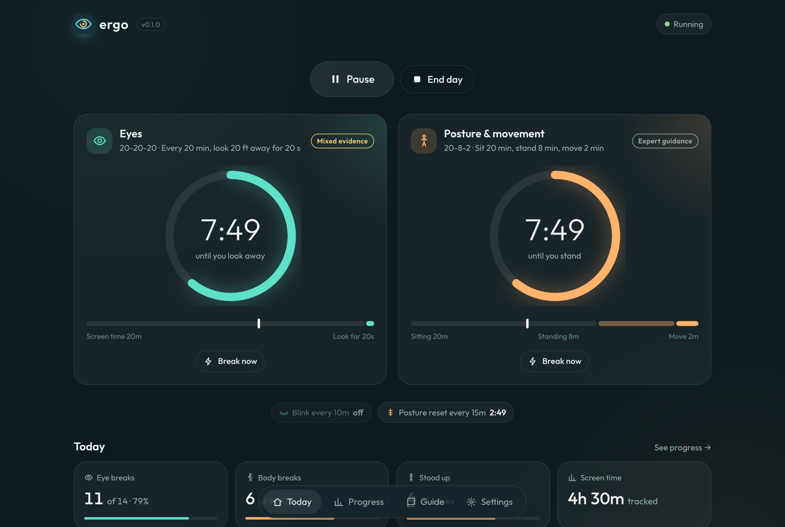
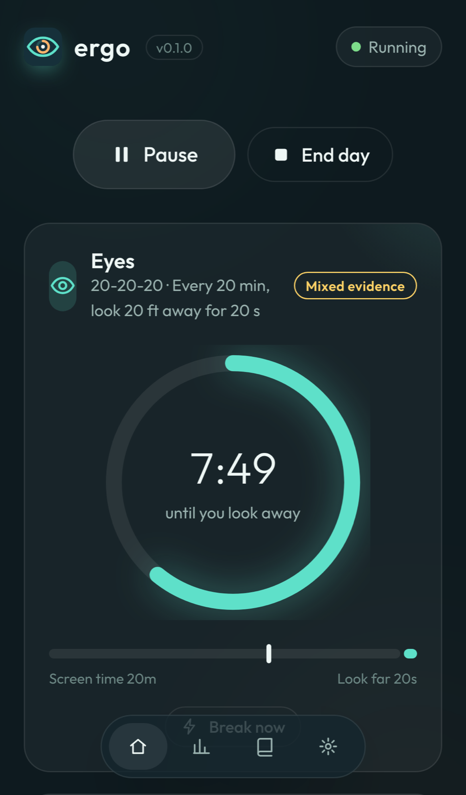
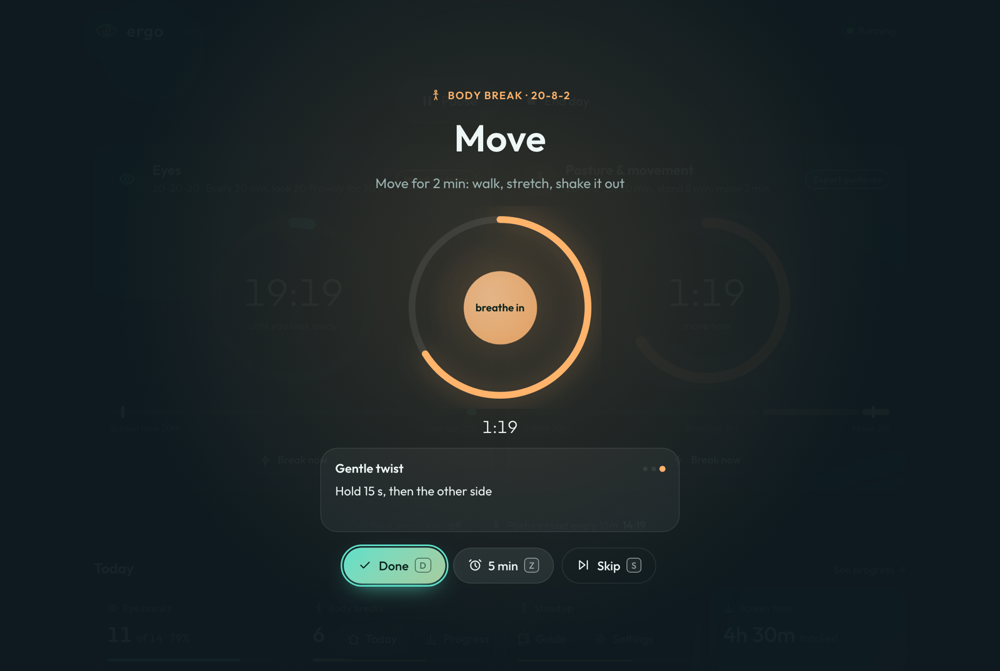
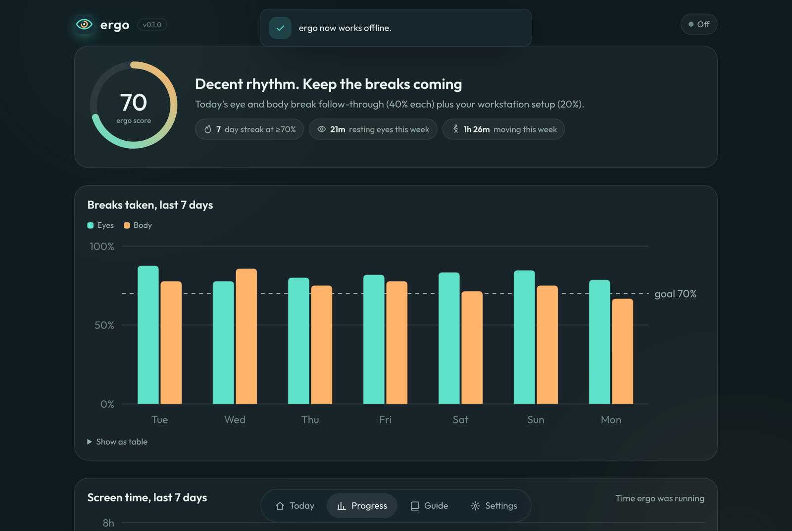

<p align="center">
  
</p>

<h1 align="center">ergo</h1>

<p align="center"><strong>look far · stand tall · move often</strong></p>

<p align="center">
  Evidence-based break reminders for your <strong>eyes</strong> and <strong>posture</strong>.<br/>
  A private, installable web app. No account, no server, no tracking.
</p>

<p align="center">
  <a href="https://parmsam.github.io/ergo/"><strong>Open the app →</strong></a>
</p>

<p align="center">
  <a href="CHANGELOG.md"></a>
  <a href="https://github.com/parmsam/ergo/actions/workflows/deploy.yml"></a>
  <a href="evidence/"></a>
  <a href="LICENSE"></a>
</p>

<p align="center">
  
  &nbsp;
  
</p>

## Why

Screen work quietly costs your eyes and body in two ways:
- **Eyes.** You blink less than half as often (5–7 times a minute instead of ~15), and your focusing muscles stay locked at one distance.
- **Body.** You sit still for hours.

Short, regular breaks help both. ergo runs two independent cycles, one for your eyes and one for your posture, and keeps you honest with a private log.

## Features

- **Two tracks at once.** An eye track (look far) and a body track (stand up, move), each with its own rule and timeline. A body break also counts as an eye break.
- **Evidence-labeled rules.** Every rule shows how well it's supported, links to a sourced write-up in [`evidence/`](evidence/), and the honest caveats.

  | Track | Rule | What it does | Evidence |
  |---|---|---|---|
  | Eyes | **20-20-20** (default) | Every 20 min, look 20 ft away for 20 s | Mixed |
  | Eyes | **30-30-30** | Every 30 min, look 30 ft away for 30 s | Expert guidance |
  | Eyes | **Hourly microbreak** | 5 min screen-off break each hour (NIOSH) | Trial |
  | Body | **20-8-2** (default) | Sit 20, stand 8, move 2 (Cornell, Hedge) | Expert guidance |
  | Body | **5 min walk / 30** | Light walk every 30 min (Duran 2023) | Trial |
  | Body | **2 min walk / 20** | Light walk every 20 min (Dunstan 2012) | Trial |
  | Both | **Custom** | Your own intervals, including sit/stand/move | – |

- **Guided, animated breaks.** Full-screen (or a gentler corner card) with a countdown and an animation that matches the break: receding rings for far gaze, a slow-blinking eye, breathing for stretches, footsteps for walks. A stepper walks you through 14 desk-friendly exercises.
- **Standing cues.** On 20-8-2, ergo prompts you to stand and keep working, with an "I'm standing" button to log it.
- **Nudges.** Optional blink and posture-reset reminders between breaks.
- **Coaching.** A daily coach note and gentle escalation: after two skipped breaks in a row, the next one goes full screen with a reason to take it.
- **Workstation checklist.** Twelve sourced setup items (screen distance and height, glare, chair, sit-stand, eye exams). Your progress feeds the score.
- **Progress.** A daily **ergo score**, a streak, and 7-day charts of breaks taken and screen time, with a table view and a full break log.
- **Reliable timing.** Cycles are derived from timestamps, not countdowns. Ticks run in a Web Worker, and chimes are scheduled on the audio clock, so background tabs don't drift. If your laptop sleeps, ergo treats it as a break and restarts fresh.
- **Meetings.** Pause for 15/30/60 min with auto-resume, or until you resume.
- **Installable and offline.** A PWA with system notifications (with Done/Snooze actions where supported).
- **Private by design.** Everything stays in `localStorage`, with JSON export/import. ergo **never** monitors your keyboard, mouse or system activity.

<p align="center">
  
  
</p>

## Keyboard shortcuts

| Key | Action |
|---|---|
| <kbd>Space</kbd> | Start / pause / resume |
| <kbd>E</kbd> / <kbd>B</kbd> | Eye break / body break now |
| <kbd>D</kbd> · <kbd>Z</kbd> · <kbd>S</kbd> | Done · snooze 5 min · skip (during a break) |
| <kbd>1</kbd>–<kbd>4</kbd> | Today · Progress · Guide · Settings |
| <kbd>?</kbd> | Help |

**Link actions** work from bookmarks, launchers or the installed app's icon menu: `?do=start`, `?do=pause&min=30`, `?do=resume`, `?do=stop`, `?do=break&lane=eye|body`.

## The evidence

Recommendations live in [`evidence/`](evidence/), one Markdown file per topic, each with:
- what ergo does with it
- a strength rating
- caveats
- linked primary sources

The sources are studies (NIOSH, Dunstan, Duran, Talens-Estarelles and others) and guidance from the AAO, OSHA and WHO. A unit test fails if any rule, tip or fact points to a missing source file.

ergo is a habit tool, **not medical advice**.

## Platform notes

- **Desktop Chrome/Edge:** best experience. Notifications with action buttons, and reliable background timing.
- **Safari (macOS):** works. Notifications need permission, and ergo must stay open in a tab or as an installed app.
- **iPhone/iPad:** add to Home Screen for notifications (iOS 16.4+). iOS suspends background web apps, so reminders only fire while ergo is open.

## Development

```sh
npm install
npm run dev          # http://localhost:5173/ergo/
npm test             # unit tests (Vitest)
npm run test:e2e     # end-to-end (Playwright: Chromium, WebKit, mobile)
npm run check        # typecheck + unit + e2e
npm run build        # production build to dist/
npm run icons        # re-render PNG icons from the logo
```

Vite + TypeScript with no UI framework; see [AGENTS.md](AGENTS.md) for conventions and [PLAN.md](PLAN.md) for the roadmap. Pushing to `main` deploys to GitHub Pages.

The version lives in `package.json`. It is shown in the app header, in Settings → About, and in the badge above. Changes are listed in [CHANGELOG.md](CHANGELOG.md).

## License

[MIT](LICENSE)
